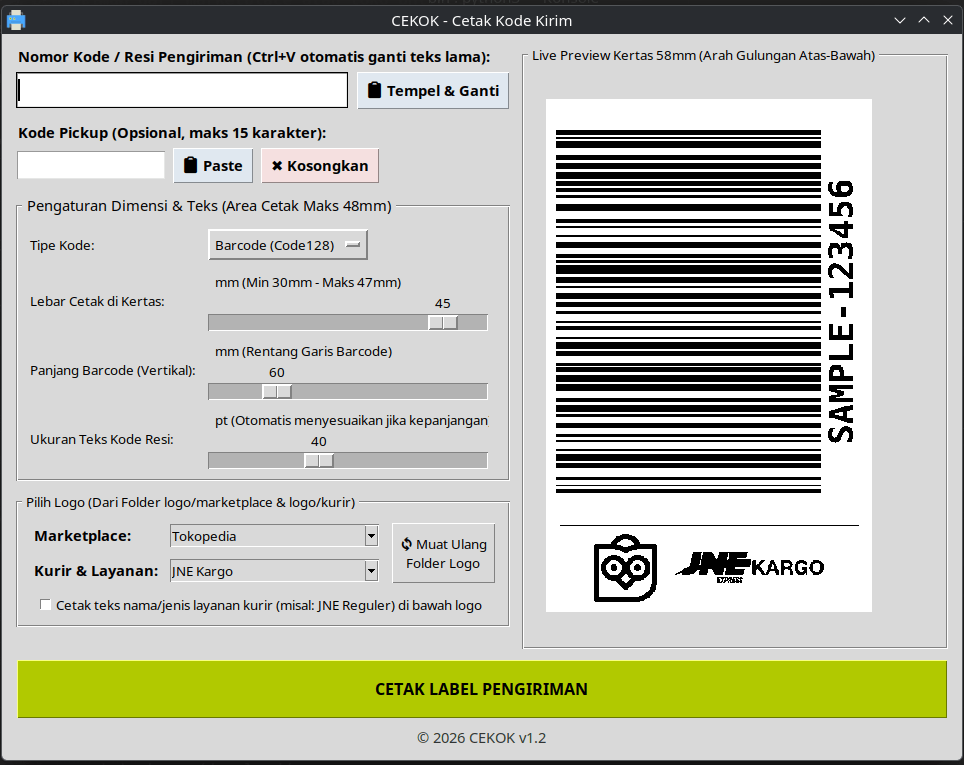

# Cekok (Cetak Kode Kirim)

Cekok adalah aplikasi Linux desktop sederhana untuk mencetak resi pengiriman dari marketplace atau toko online, yang berbasis Python dan Tcl/Tk.

Barcode/QR code sengaja dibuat besar supaya bisa dicetak oleh printer thermal murah meriah dan tetap terbaca oleh berbagai scanner/reader.

## Latar Belakang

Aplikasi ini dibuat untuk membuat resi pengiriman dengan printer thermal murah sejuta umat berukuran 58mm. Dilatarbelakangi karena terlanjur salah beli printer 58mm sedangkan untuk mencetak resi dari marketplace dibutuhkan printer ukuran A6 (10cm) atau 80mm. Dari pada tidak terpakai, akhirnya dimanfaatkan saja.

## Fitur

- Mencetak label pengiriman/resi pada kertas thermal printer lebar 58mm.
- Menampilkan kode pengiriman/resi/AWB berupa barcode dan/atau QR code.
- Menampilkan (atau tidak) logo marketplace atau toko sendiri (dengan domain sendiri) dan logo kurir.

## Persyaratan _(Requirement)_

1. Aplikasi ini membutuhkan komputer/laptop Linux anda sudah berhasil terhubung dengan printer thermal, baik melalui bluetooth atau USB. Silakan mengacu pada dokumentasi printer yang miliki.

        Penulis menggunakan printer seharga 200 ribuan yang terdeteksi sebagai `Printer58` (RPP02N) dengan koneksi bluetooth menggunakan driver dari `https://www.rongtatech.com/download/   

2. 
